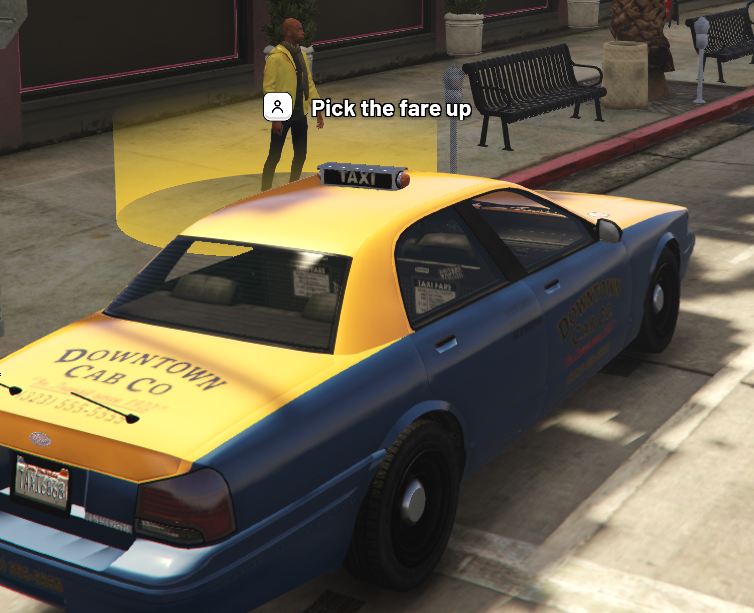
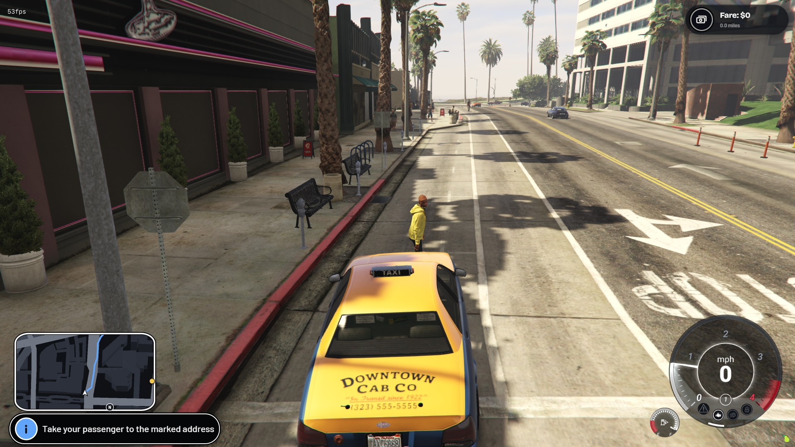
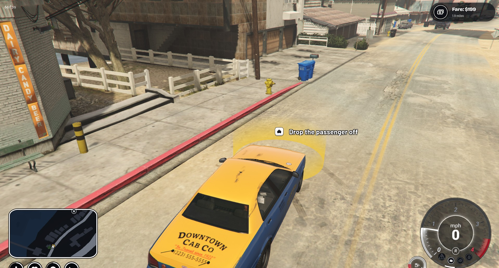

# whip-taxijob

A taxi job for **WhipFX**. A depot clerk signs cabs out, fares are hailed around Los Santos, and
the meter rides on a WhipFX objective card instead of its own NUI page.

Built on `whip_core` only — no qbx_core, no ox_lib, no ox_target, no ox_inventory.

---

## Requirements

- `whip_core` (`whip_requires '1.0'`)

```
ensure whip_core
ensure whip-taxijob
```

---

## Going on duty

`Config.DutyMode` decides who may drive and how they go on duty. The job itself is created on start
whichever you pick, so this is the only line that has to change.

| Mode | Who may drive | The clerk offers |
| --- | --- | --- |
| `'open'` | Anyone, with no duty at all | Just the cabs |
| `'signon'` *(default)* | Anyone who signs on | **Sign on as a driver** / **Sign off** |
| `'hired'` | Only drivers hired in `/whip → Economy → Jobs` | **Clock on** / **Clock off** |

On `'signon'` a driver who walks up to the clerk is taken on at the starting role and put on duty in
one go — nobody has to be hired by hand first. Signing off clocks them out, and with
`Config.ReleaseOnSignOff = true` it also lets them go, so the roster does not fill up with everyone
who ever drove a cab. Anyone promoted above the starting role keeps their job either way.

You have to park your cab up before you can sign off.

---

## How a shift runs

### 1. Sign a cab out

Walk up to the depot clerk at the Downtown Cab Co. rank (marked on the map) and pick a cab from the
prompt. A deposit (`Config.CabDeposit`) is taken, and the cab is brought out on the first clear spot
on the rank with the key already in the ignition.

Unless `Config.DutyMode` is `'open'`, you have to be on duty first — see above.

### 2. Pick the fare up

A fare is marked on your GPS. Drive over and take the prompt on the waiting ped — they get in and
you are given an address.



### 3. The meter

The meter starts the moment the passenger is aboard. It is a WhipFX objective card in the top right,
showing the running fare and the distance covered — there is no meter to switch on and no NUI panel
to drag around.



With `Config.Meter.useGpsPrice = true` the fare bills the GPS route to the address, filled in as the
cab covers it; set it to `false` to bill raw distance driven instead.

### 4. Drop them off



Taking the drop-off prompt settles the meter, pays you (with a chance of a tip and of
`Config.ChanceItem`), and a fresh fare is marked straight away.


### 5. Park up

Bring the cab back to the rank and take the **Park the cab up** prompt. The cab is despawned and the
deposit is returned.


Walking away from the cab for `Config.AwaySeconds` cancels the shift instead — the cab is removed and
the deposit is forfeited.

---

## Configuration

| File | What's in it |
| --- | --- |
| `config/config.lua` | Job, deposit, meter rates, fares, tips, the depot and its clerk |
| `config/locations.lua` | Pickup addresses, drop-off addresses, the cab rank, passenger models |
| `locales/en.lua` | Every string the job shows |

Settings worth knowing:

| Setting | Does |
| --- | --- |
| `Config.DutyMode` | `'open'`, `'signon'` or `'hired'` — see **Going on duty**. |
| `Config.ReleaseOnSignOff` | `'signon'` only: let a casual driver go when they sign off. |
| `Config.CabDeposit` | Taken when a cab is signed out, returned when it is parked up, forfeited if it is ditched. |
| `Config.Meter.pricePerMile` | What a mile of the route is worth. |
| `Config.Meter.useGpsPrice` | Bill the GPS route rather than raw distance driven. |
| `Config.MaxFare` | The server refuses any fare above this. |
| `Config.TipChance` / `Config.Tip` | Chance of a tip on top of the fare, and its range. |
| `Config.ChanceItem` | An item that may come with a fare. Set to `nil` to turn it off. |
| `Config.Vehicles` | The cabs the clerk will sign out. |
| `Config.DebugMarkers` | Draws every pickup and drop-off marker, for laying out new ones. |

The job is created on start with `EnsureJob`. Hire and fire drivers in `/whip → Economy → Jobs`.

---

## What it uses from whip_core

**Server** — `EnsureJob`, `SpawnNpc` / `SetNpcState`, `ShowBlip`, `SecureCallback` / `SecureEvent`,
`ChargePlayer` / `RefundPlayer` / `PayPlayer`, `SpawnTempVehicle` / `DespawnVehicle` / `GetVehicle`,
`GetPlayerVehicle`, `IsSessionCurrent`, `AddItem`, `NotifyPlayer`, `IsPlayerClockedOn`,
`HirePlayer` / `FirePlayer` / `GetPlayerRole`, `ClockOn` / `ClockOff`, `RecordEventRejection`.

**Client** — `AddAction` / `RemoveAction`, `ShowObjective` / `HideObjective`, `Callback`, `Notify`,
`LoadModel`, `ClockOn` / `ClockOff` / `IsPlayerClockedOn`.

Every value a client sends is declared on a `SecureEvent` or `SecureCallback`, so whip_core checks
who asked, how often, from where and what before a handler runs. The fare the client reports is
capped at `Config.MaxFare`, has a cooldown between payouts, and is only paid to the player driving
the cab they signed out.
